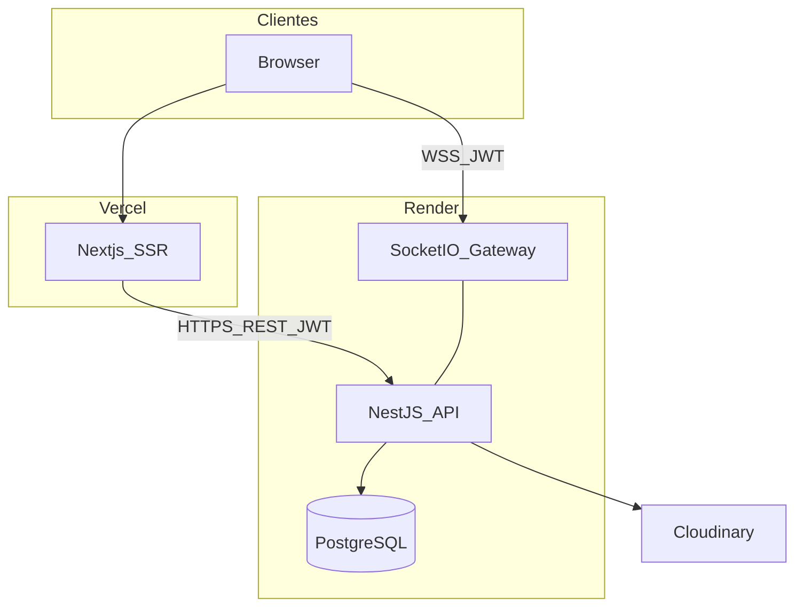
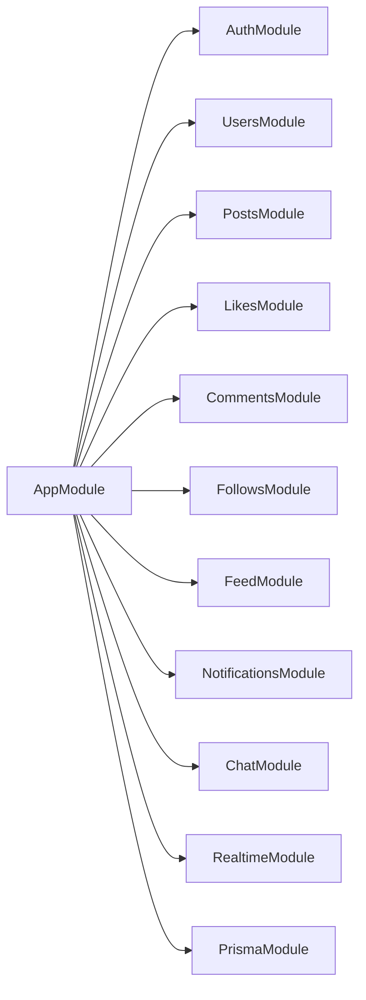
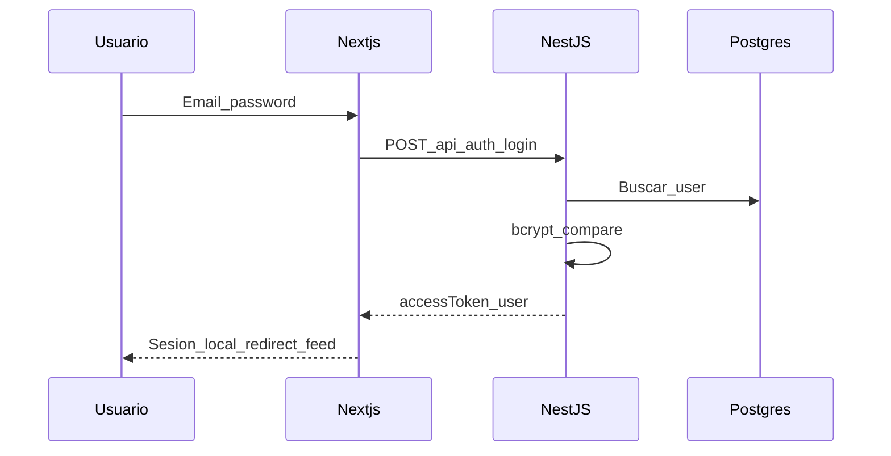
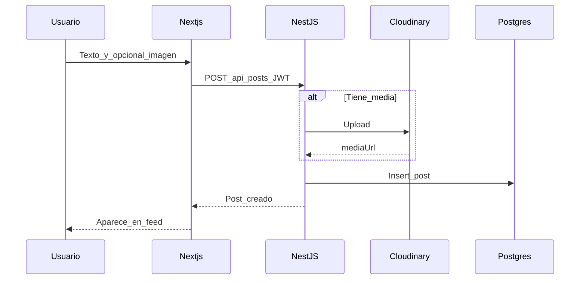
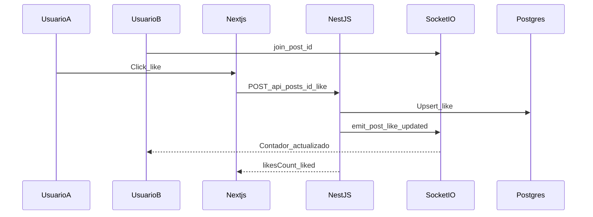
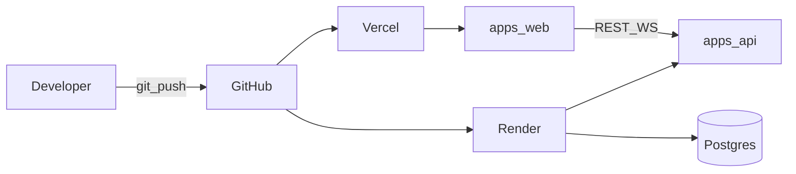

# Current Global — Arquitectura

## 1. Resumen

Current Global sigue una **arquitectura cliente-servidor** con separación clara:

- **Frontend (`apps/web`):** Next.js App Router (SSR/prerender) en Vercel.
- **Backend (`apps/api`):** NestJS (REST + Socket.IO) en Render.
- **Base de datos:** PostgreSQL con Prisma (migraciones reproducibles).
- **Media:** Cloudinary para imágenes de publicaciones/avatares.



## 2. Estilo C4-lite

### Contenedores

| Contenedor | Responsabilidad |
|------------|-----------------|
| Web | UI, SSR de feed/perfil, auth client, sockets client |
| API | Dominio, validación, persistencia, emisión de eventos WS |
| DB | Persistencia relacional |
| Cloudinary | Hosting de media |

### Contexto

Usuarios autentican contra la API; el frontend nunca habla directo a la BD. Los eventos en tiempo real salen del mismo proceso NestJS (gateway Socket.IO) para simplificar el MVP.

## 3. Monorepo

```
/
  apps/
    web/                 # Next.js (App Router)
    api/                 # NestJS + Prisma
  docs/                  # Documentación de arquitectura
  docker-compose.yml     # PostgreSQL 16 local
  .env.example
  README.md
  package.json           # npm workspaces (apps/*)
```

**BD local:** `docker compose up -d` (o `npm run db:up`) levanta Postgres en `:5432` con DB `current_global`. Producción usa Render Postgres (sin Compose).

## 4. Backend — módulos NestJS



| Módulo | Responsabilidad |
|--------|-----------------|
| Auth | Registro, login, emisión JWT, guards |
| Users | Perfil, búsqueda básica por username |
| Posts | CRUD posts + upload media |
| Likes | Toggle like + emit contador |
| Comments | Crear/listar + emit contador |
| Follows | Follow/unfollow + notificación |
| Feed | Feed global y following |
| Notifications | Persistencia + push `notification:new` |
| Chat | Conversaciones 1-a-1 y mensajes |
| Realtime | Gateway Socket.IO, rooms, auth handshake |
| Prisma | Acceso a BD |

**Cross-cutting:** `ValidationPipe` global, exception filter uniforme, `JwtAuthGuard`, CORS desde env.

## 5. Frontend — rutas y renderizado

| Ruta | Render | Notas |
|------|--------|-------|
| `/login`, `/register` | CSR / Server Components + forms | Público |
| `/` o `/feed` | SSR | Feed general/personalizado |
| `/u/[username]` | SSR | Perfil + posts |
| `/chat`, `/chat/[id]` | CSR | Requiere socket |
| Layout | Server | Nav, badge de notifs (cliente) |

**SSR:** feed y perfil se hidratan con datos del backend desplegado (`NEXT_PUBLIC_API_URL`).  
**Cliente:** likes, contadores, notificaciones y chat usan Socket.IO.

## 6. Comunicación

### REST

- Base: `https://<api-host>/api/...`
- Auth: `Authorization: Bearer <jwt>`
- Errores: `{ statusCode, message, error }`
- Docs: `GET /api/docs` (Swagger UI)

### WebSocket (Socket.IO)

- URL: `NEXT_PUBLIC_WS_URL` (mismo host API en MVP)
- Auth: token JWT en handshake (`auth.token` o header)
- Rooms: `user:{id}`, `post:{id}`, `conversation:{id}`
- Detalle de eventos en [`04-realtime.md`](04-realtime.md)

## 7. Flujos de secuencia

### Login



### Crear post



### Like en vivo



## 8. Despliegue



Variables por entorno documentadas en [`05-security.md`](05-security.md) y [`06-deployment.md`](06-deployment.md).

## 9. Principios de diseño

1. **Separación FE/BE** estricta (requisito académico).
2. **Un solo bounded context** social (MVP); módulos por agregado.
3. **Contrato primero:** OpenAPI como fuente de verdad de la API.
4. **Eventos derivados del dominio:** el write en REST dispara el emit WS.
5. **Secretos fuera del repo:** solo `.env.example`.
6. **Migraciones versionadas:** Prisma Migrate, nunca `db push` en prod.

## 10. Escalabilidad (consciente, no sobre-ingeniería)

- Paginación cursor/offset en feeds y mensajes.
- Índices en FKs y `createdAt` (ver modelo).
- Socket rooms acotadas (no broadcast global innecesario).
- Posible evolución: Redis adapter para Socket.IO multi-instancia (fuera del MVP).
