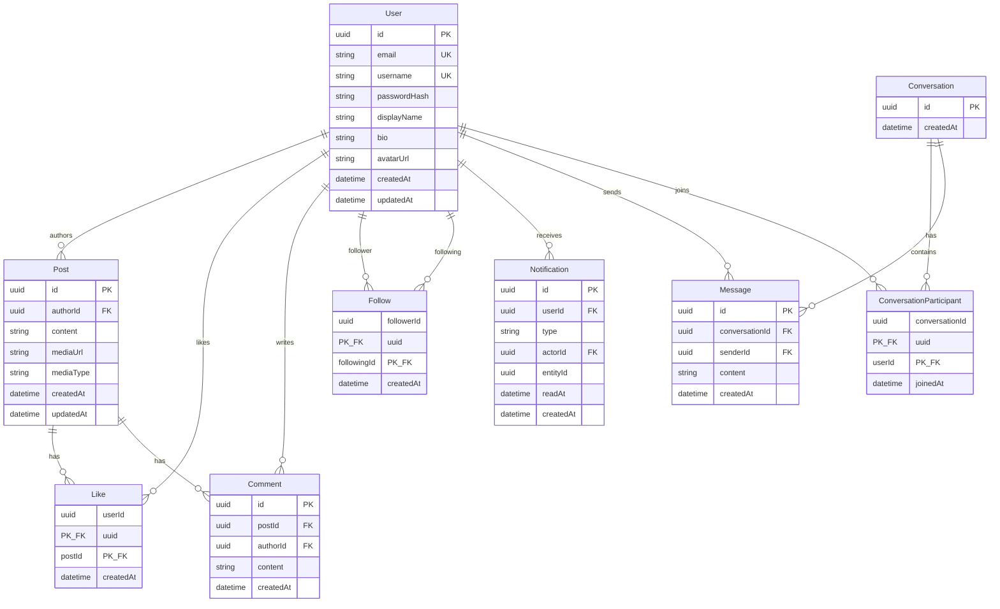

# Current Global — Modelo de datos

## 1. Motor y ORM

- **SGBD:** PostgreSQL 15+
- **ORM / migraciones:** Prisma
- **Ubicación prevista del schema:** `apps/api/prisma/schema.prisma`
- **Migraciones:** `apps/api/prisma/migrations/` (reproducibles en local y Render)

## 2. Diagrama ER

## 3. Entidades y reglas

### User
| Campo | Tipo | Reglas |
|-------|------|--------|
| id | UUID | PK |
| email | VARCHAR(255) | UNIQUE, NOT NULL, lowercased |
| username | VARCHAR(30) | UNIQUE, NOT NULL, `[a-z0-9_]` |
| passwordHash | VARCHAR | bcrypt cost ≥ 10; nunca se expone en API |
| displayName | VARCHAR(80) | NOT NULL |
| bio | TEXT | opcional, max 500 |
| avatarUrl | TEXT | opcional (Cloudinary) |
| createdAt / updatedAt | TIMESTAMPTZ | automáticos |

### Post
| Campo | Tipo | Reglas |
|-------|------|--------|
| id | UUID | PK |
| authorId | UUID | FK → User, ON DELETE CASCADE |
| content | TEXT | max 2000; requerido si no hay media |
| mediaUrl | TEXT | opcional |
| mediaType | ENUM/VARCHAR | `image` \| `null` |
| createdAt / updatedAt | TIMESTAMPTZ | |

**Eliminación:** hard delete por el autor (requisito: creación, visualización y eliminación). Cascada a likes/comentarios.

### Like
- PK compuesta `(userId, postId)` → un like por usuario/post.
- Toggle: si existe, eliminar; si no, crear.

### Comment
- `content` max 500, NOT NULL.
- Solo el autor puede eliminar (opcional MVP); listado por post.

### Follow
- PK `(followerId, followingId)`.
- CHECK / validación app: `followerId ≠ followingId`.
- Índice inverso para “seguidores de X”.

### Notification
| type | entityId apunta a |
|------|-------------------|
| `LIKE` | postId |
| `COMMENT` | commentId o postId |
| `FOLLOW` | follower userId |
| `MESSAGE` | conversationId (opcional) |

`readAt` null = no leída.

### Chat
- **Conversation:** contenedor 1-a-1.
- **ConversationParticipant:** exactamente 2 usuarios en MVP; unique pair lógico (buscar conversación existente antes de crear).
- **Message:** texto; max 2000.

## 4. Índices recomendados

| Tabla | Índice | Motivo |
|-------|--------|--------|
| Post | `(createdAt DESC)` | Feed global |
| Post | `(authorId, createdAt DESC)` | Perfil |
| Like | `(postId)` | Contadores / listados |
| Comment | `(postId, createdAt)` | Hilo de comentarios |
| Follow | `(followingId)` | Seguidores |
| Follow | `(followerId)` | Siguiendo (feed personalizado) |
| Notification | `(userId, createdAt DESC)` | Inbox |
| Message | `(conversationId, createdAt)` | Historial chat |

## 5. Consultas de dominio clave

**Feed global:** posts ordenados por `createdAt DESC` con author, `_count.likes`, `_count.comments`, flag `likedByMe`.

**Feed following:** posts donde `authorId IN (SELECT followingId FROM Follow WHERE followerId = me)`.

**Chat DM:** buscar Conversation que contenga exactamente a `me` y `other`; si no existe, crear.

## 6. Migraciones

1. `prisma migrate dev --name init` en desarrollo.
2. En Render: `prisma migrate deploy` antes de arrancar la API (el plan free no tiene pre-deploy).
3. Seed opcional (`prisma/seed.ts`) con 2–3 usuarios demo para demos/capturas.

## 7. Mapeo Prisma

Fuente de verdad: [`apps/api/prisma/schema.prisma`](../apps/api/prisma/schema.prisma).

Migración inicial aplicada: `apps/api/prisma/migrations/*_init/`.

Modelos implementados: `User`, `Post`, `Like`, `Comment`, `Follow`, `Notification` (+ enum `NotificationType`), `Conversation`, `ConversationParticipant`, `Message`.

Seed local (`npm run db:seed`): usuarios `alice` y `bob` (`Password123!`).
