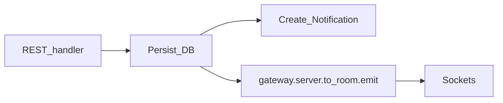

# Current Global — Tiempo real (Socket.IO)

## 1. Objetivo (rúbrica: 2 pts)

Demostrar funcionalidad activa con WebSockets:

1. Notificaciones instantáneas
2. Contadores de likes/comentarios actualizados en vivo
3. Chat 1-a-1 en vivo

## 2. Transporte

| Ítem | Valor |
|------|-------|
| Librería | Socket.IO (NestJS Gateway + client `socket.io-client`) |
| URL | `NEXT_PUBLIC_WS_URL` (mismo host que API en MVP) |
| Path | default `/socket.io` |
| Auth | JWT en handshake |

### Handshake

Cliente:
```ts
io(WS_URL, { auth: { token: accessToken } })
```

Servidor (`RealtimeGateway`):
- Extrae `client.handshake.auth.token`
- Verifica JWT
- Asocia `socket.data.userId`
- Auto-join room `user:{userId}`

Sin token válido → desconectar con error `UNAUTHORIZED`.

## 3. Rooms

| Room | Quién se une | Propósito |
|------|--------------|-----------|
| `user:{userId}` | Al conectar | Notificaciones y mensajes dirigidos |
| `post:{postId}` | Al abrir/ver un post en feed o detalle | Contadores live |
| `conversation:{id}` | Al abrir un chat | Mensajes del hilo |

Cliente emite:
- `post:subscribe` / `post:unsubscribe` con `{ postId }`
- `conversation:subscribe` / `conversation:unsubscribe` con `{ conversationId }`

Servidor valida membresía en conversaciones antes de permitir subscribe.

## 4. Eventos servidor → cliente

### `notification:new`
```json
{
  "id": "uuid",
  "type": "LIKE | COMMENT | FOLLOW | MESSAGE",
  "actor": { "id", "username", "displayName", "avatarUrl" },
  "entityId": "uuid",
  "createdAt": "ISO-8601"
}
```
**Room:** `user:{recipientId}`

### `post:like:updated`
```json
{ "postId": "uuid", "likesCount": 12, "userId": "uuid", "liked": true }
```
**Room:** `post:{postId}`

### `post:comment:updated`
```json
{ "postId": "uuid", "commentsCount": 4, "comment": { /* opcional preview */ } }
```
**Room:** `post:{postId}`

### `chat:message:new`
```json
{
  "id": "uuid",
  "conversationId": "uuid",
  "senderId": "uuid",
  "content": "Hola",
  "createdAt": "ISO-8601"
}
```
**Rooms:** `conversation:{id}` y `user:{peerId}` (para badge si no está en el hilo)

## 5. Flujo de dominio → emit



Regla: **el write REST es la fuente de verdad**; el WS solo notifica. El cliente optimista puede actualizar UI local y reconciliar con el evento.

## 6. Demo de evaluación (checklist)

1. Abrir Current Global en dos navegadores (usuarios A y B).
2. B ve el post de A → contador likes = 0.
3. A da like → B ve el contador subir sin refresh.
4. B comenta → A recibe notificación toast + badge.
5. A abre chat con B, envía mensaje → B lo recibe al instante.

## 7. Consideraciones de producción

- MVP: un solo proceso NestJS (sin Redis adapter).
- Si se escala a N réplicas: añadir `@socket.io/redis-adapter` (fuera de alcance actual).
- Heartbeat default de Socket.IO suficiente.
- No persistir eventos WS; la verdad está en PostgreSQL.
