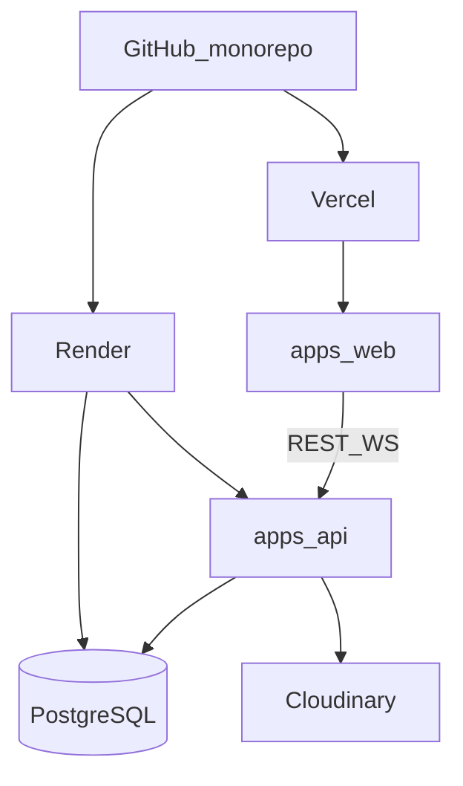

# Current Global — Despliegue

## 0. Desarrollo local (Docker)

Para pruebas locales de BD (épica E2), **no** se usa Render:

```bash
npm run db:up          # docker compose → postgres:16-alpine :5432
npm run db:migrate     # prisma migrate dev
npm run dev:api        # NestJS :3001
npm run dev:web        # Next.js :3000
```

Credenciales Compose: user/pass `current` / `current`, DB `current_global` (ver `.env.example` y `docker-compose.yml`).

---

## 1. Objetivo (rúbrica: 3 pts + evitar −3)

Frontend y backend **públicos y funcionales**. El PDF y el README deben incluir URLs vivas.

| Recurso | Plataforma | URL (rellenar al desplegar) |
|---------|------------|------------------------------|
| Frontend | Vercel | `https://_____.vercel.app` |
| Backend | Render | `https://_____.onrender.com` |
| Swagger | mismo backend | `https://_____.onrender.com/api/docs` |
| BD | Render Postgres | solo `DATABASE_URL` privada |

Railway quedó descartado: tras el incidente del 21 de octubre de 2026 no se puede iniciar sesión de nuevo en la cuenta existente. El blueprint está en [`render.yaml`](../render.yaml).

## 2. Arquitectura de despliegue



## 3. Backend (Render)

1. Subir el monorepo a GitHub (rama `main`).
2. En el dashboard: **New → Blueprint** y elegir el repo. Render lee `render.yaml`.
3. El blueprint crea el web service `current-global-api` (plan free) y Postgres `current-global-db` (PostgreSQL 16, plan free).
4. Variables: `DATABASE_URL` sale de la base; `JWT_SECRET` lo genera Render; `JWT_EXPIRES_IN=7d`, `BCRYPT_ROUNDS=12`, `NODE_ENV=production`, `NODE_VERSION=22`.
5. Build desde la raíz del monorepo: `npm ci --include=dev && npm run build -w api`.
6. El plan free no admite pre-deploy. El arranque ejecuta `npm run prisma:deploy -w api` y después `npm run start:prod -w api`. El proceso escucha `0.0.0.0` y el `PORT` de Render.
7. Verificar: `GET /api/health` y `/api/docs`.

El Postgres free caduca a los 30 días (luego hay 14 días para pasarlo a un plan de pago). Cloudinary solo si hay cloud name, key y secret; si no, el despliegue sigue con posts de texto.

### CORS
Tras conocer la URL de Vercel:
```
CORS_ORIGIN=https://<proyecto>.vercel.app
```
Guardar la variable en el servicio de Render y volver a desplegar.

## 4. Frontend (Vercel)

1. Importar el monorepo; root directory `apps/web`.
2. Framework preset: Next.js.
3. Env:
   ```
   NEXT_PUBLIC_API_URL=https://<api>.onrender.com/api
   NEXT_PUBLIC_WS_URL=https://<api>.onrender.com
   ```
4. Deploy production.
5. Verificar login → feed contra API real (no localhost).

## 5. Cloudinary

1. Crear cuenta free.
2. Copiar cloud name, API key, API secret a Render, en el servicio `current-global-api`: `CLOUDINARY_CLOUD_NAME`, `CLOUDINARY_API_KEY`, `CLOUDINARY_API_SECRET`.
3. La API sube a la carpeta `current-global/posts`.
4. **Antes de probar imágenes en producción**, confirmar que esas tres variables ya están guardadas. Sin ellas el selector del frontend funciona, pero `POST /api/posts` con archivo responde 503 y no escribe en el disco de Render.
5. Smoke de imágenes: publicar un post con imagen en el frontend público y verla en el feed y en el perfil. Un post de solo texto debe seguir publicándose igual.
6. El buscador (`GET /api/users/search`) no depende de Cloudinary. Smoke: buscar un username existente desde la barra y abrir su perfil.

## 6. Orden recomendado

1. BD + migraciones (las aplica el arranque del API)
2. API + Swagger públicos
3. Configurar `CORS_ORIGIN` provisional solo para el humo, luego restringir al dominio Vercel
4. Frontend con URLs de API
5. Ajustar CORS al dominio Vercel final
6. Actualizar README URLs
7. Capturas para PDF

## 7. Checklist anti-penalización (−3)

- [ ] Frontend abre sin error de red hacia API
- [ ] Backend responde en dominio público
- [ ] `/api/docs` accesible sin VPN
- [ ] Registro + login funcionan en prod
- [ ] Al menos un post visible en feed prod
- [ ] Variables `CLOUDINARY_*` definidas en Render antes del smoke de imágenes
- [ ] Un post con imagen se ve en el feed y en el perfil de producción
- [ ] El buscador de la barra encuentra un usuario y abre su perfil
- [ ] Socket conecta (wss) en prod
- [ ] Enlaces pegados en README y PDF (sin typos)

## 8. Dominios custom (opcional)

No requerido. Suficiente `*.vercel.app` + `*.onrender.com`.

## 9. Rollback

- Vercel: Instant Rollback al deployment anterior.
- Render: redeploy del commit previo; migraciones Prisma deben ser backward-compatible cuando sea posible.
